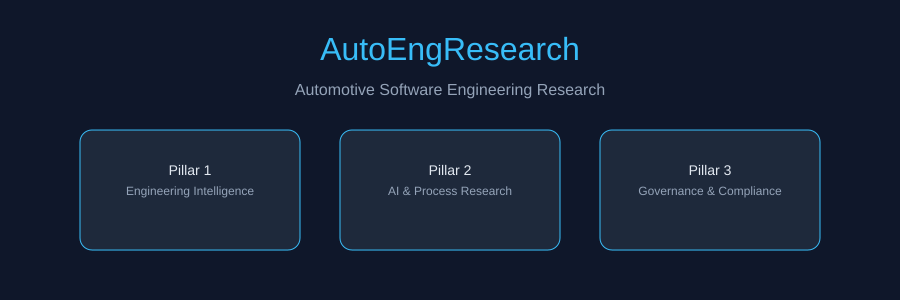

# AutoEngResearch

**Automotive Software Engineering Research**  
Author: Pratik Patil · Contact: pratik.patil082@gmail.com  
Copyright (c) 2026 Pratik Patil. All rights reserved.

## Table of contents

- [Mission](#mission)
- [Foundational pillars](#foundational-pillars)
- [Repository structure](#repository-structure)
- [Research navigation](#research-navigation)
- [Copyright](#copyright)

## Mission

Build a structured, evidence-based research corpus for automotive software engineering problems, gaps, and future opportunities.

## Foundational pillars

1. **Automotive Engineering Intelligence** — discover real problems across the lifecycle.
2. **Technology, AI & Process Research** — investigate tools, automation, AI, and workflows.
3. **Governance, Safety & Compliance** — ensure IP, AI governance, safety, and regulations.

## Repository structure

- `research/` — primary research content
- `research/book/` — 45-chapter research book
- `research/artefacts/` — 14 supporting artefacts
- `engineering/` — Rust AUTOSAR tooling and templates
- `docs/` — supporting documentation
- `assets/` — branding and diagrams

## Research navigation

- [Migration plan](research/REPO_MIGRATION_PLAN.md)
- [Cross-reference index](research/CROSS_REFERENCE_INDEX.md)
- [Knowledge index](research/KNOWLEDGE_INDEX.md)
- [Book index](research/book/INDEX.md)
- [AI governance](research/ai_governance/README.md)

## Copyright

All content is copyright Pratik Patil. Permission required for use or reproduction. See [COPYRIGHT.md](COPYRIGHT.md).